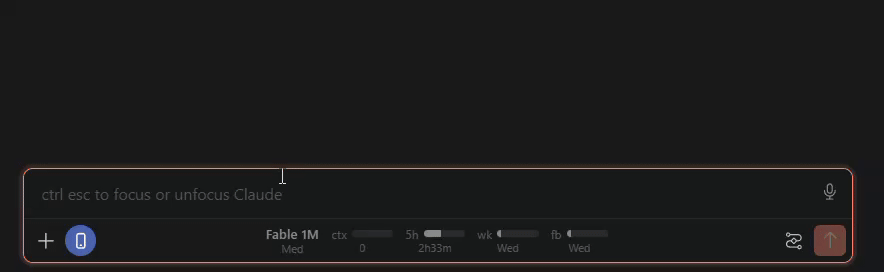

# vsce-claude-clarity

Puts the current model, context usage, and rate limits in the Claude Code VS Code extension's input row.

<p align="center"></p>

- **model · effort** — click the model name for a model × effort grid; click a cell to switch both at once (Ultra = the app's Ultracode toggle)
- **ctx** — context tokens against the usable window, orange past 90%
- **5h** — session rate limit, with time until reset
- **wk** — weekly rate limit, with reset day
- **fb** — the model-scoped Fable weekly quota, with reset day
- **no duplicate model button** — the app's own model switcher is hidden from the input row, since the badge's grid replaces it
- **icon-only permission button** — the permission-mode button drops its text label and sits as a 26px icon like its neighbours; hover for the mode description
- **Remote Control pill toggles** — the pill is icon-only at every width, and clicking it turns Remote Control off (same as `/remote-control`) instead of opening claude.ai/code; hover for the status
- **share selection, one message at a time** — the "share current file/selection" button defaults off and resets to off right after each send, instead of the app's sticky-on default silently carrying a stale selection into later messages

Hover any bar for exact numbers.

Rate limits come from the same `get_usage` query the app's own `/usage` panel runs — fetched on startup, after each turn, and every 5 minutes. Context, model, and effort are read from the app's own session state, so the badge always agrees with the app.

## Install

```
node apply.mjs
```

Then `Developer: Reload Window`. It patches the installed extension's webview bundle in place — **extension updates remove it, so rerun after each update.**

## Uninstall

```
node apply.mjs --remove
```

## Layout

- `apply.mjs` — the patcher: strips any previous shim, applies anchor patches (exposes the displayed session as `window.__ccActiveSession`; hides the app's model button; makes the permission-mode button and Remote Control pill icon-only; defaults the share-selection toggle off and resets it after each send), and appends the shim assembled from `src/`.
- `src/` — the shim, concatenated into one IIFE: `debug` → `state` → `format` → `session` (session access, model catalog, setters) → `usage` (the `get_usage` fetch + push ingest) → `popup` (model × effort grid) → `badge` (DOM + render) → `main` (boot).
